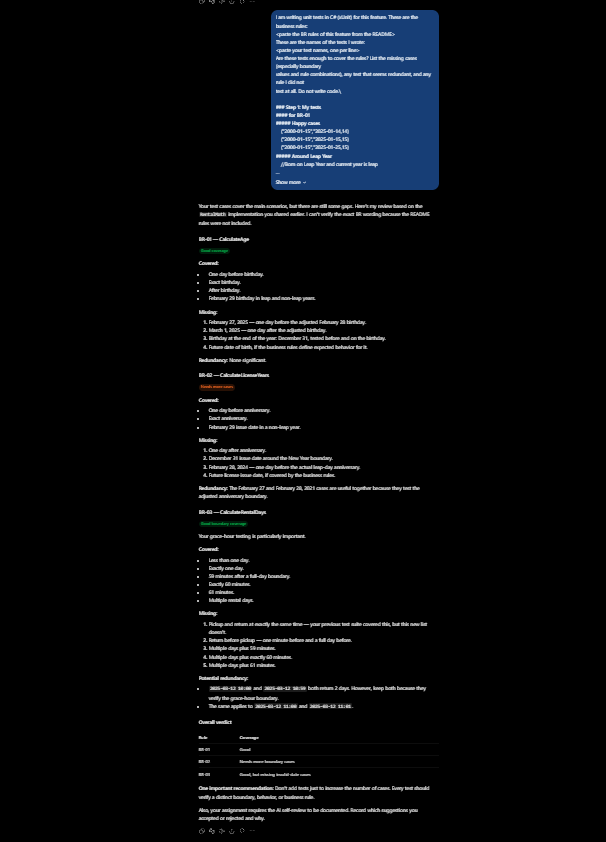

# TESTS.md
Name: Youssef Hany  ,Group : Monday/Thursday

## Feature: RentalMath (BR-01 to BR-03)

### Step 1: My tests
#### for BR-01
##### Happy cases
    ("2000-01-15","2025-01-14,14)
    ("2000-01-15","2025-01-15,15)
    ("2000-01-15","2025-01-25,15)
##### Around Leap Year
    //Born on Leap Year and current year is leap
    ("2000-02-29", "2024-02-28", 23)
    ("2000-02-29", "2024-02-29", 24)
    // Born on Leap Year and current year is not leap
    ("2000-02-29", "2025-02-28", 25)

#### for BR-02
        [InlineData("2020-05-10", "2021-05-09", 0)]
        [InlineData("2020-05-10", "2021-05-10", 1)]
        [InlineData("2016-02-29", "2021-02-27", 4)]
        [InlineData("2016-02-29", "2021-02-28", 5)]
        [InlineData("2016-02-29", "2021-03-01", 5)]
#### for BR-03
        // less than one day: minimum is 1
        [InlineData("2025-03-10 10:01", 1)]
        [InlineData("2025-03-10 11:00", 1)]
        [InlineData("2025-03-11 09:59", 1)]
        // exactly one day, and inside the grace hour
        [InlineData("2025-03-11 10:00", 1)]
        [InlineData("2025-03-11 10:59", 1)]
        // grace hour edge
        [InlineData("2025-03-11 11:00", 1)] // exactly 60 min doesnt count
        [InlineData("2025-03-11 11:01", 2)]
        //more than one day
        [InlineData("2025-03-12 10:00", 2)]
        [InlineData("2025-03-12 10:59", 2)]
        [InlineData("2025-03-12 11:00", 2)]
        [InlineData("2025-03-12 11:01", 3)]

### Step 2: Self-judgement
    i see my tests cover all cases

### Step 3: AI review

    

### Step 4: Decision
- my tests are good

### Step 5: Judging the AI

- complicating simple things 

